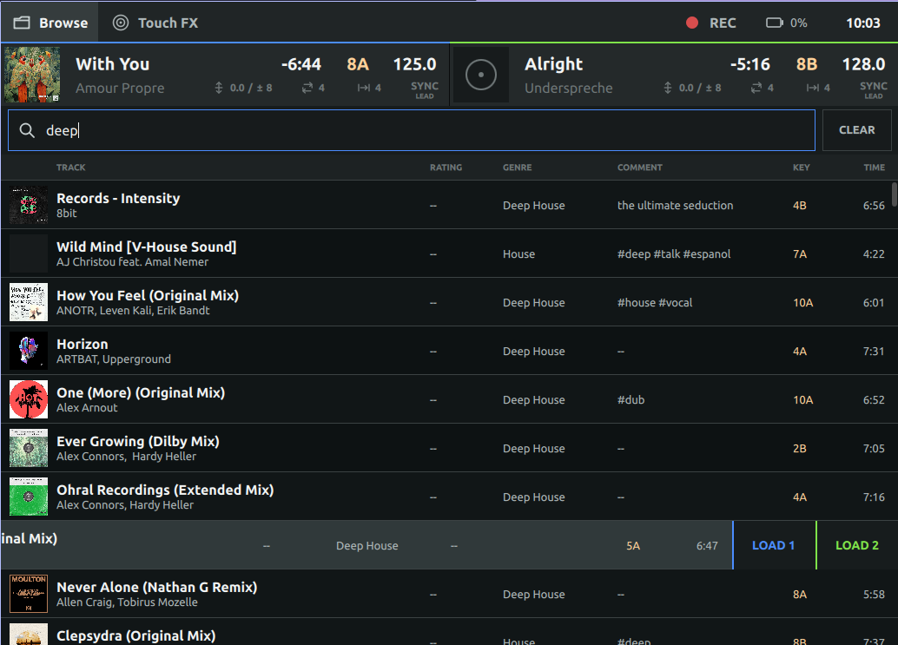
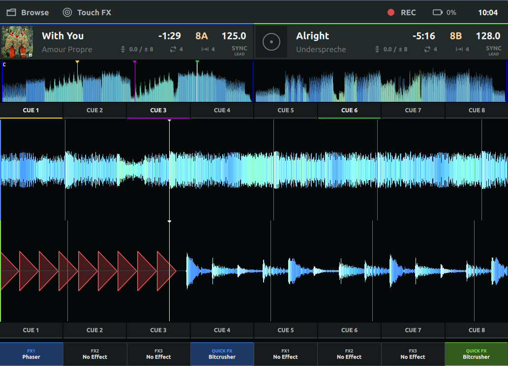

# TouchQML for Mixxx

Experimental touch-first QML skin for Mixxx. It targets two-deck workflows on
landscape touchscreens from 1024 x 600 through 1920 x 1080 logical pixels.

**Recommended resolution: 1280 x 800 logical pixels (16:10)**, either on a
native 1280 x 800 display at 100% scaling or through desktop scaling on a
higher-resolution panel. The current 14-inch, 1920 x 1200, 60 Hz touchscreen
provides this logical resolution at 150% scaling. Keep the panel at its native
physical resolution; scaling changes the logical workspace, not the refresh
rate. This is the primary design target, not a fixed window size or a change
to the minimum supported resolution. See [display requirements](docs/design.md#target-displays).

TouchQML currently provides:

- Fixed navigation, deck status, and full-track overview rows
- Stacked RGB scrolling waveforms with beat, cue, hotcue, and loop markers
- Full-width 1 x 8 hotcue strips using stored Mixxx cue colors
- Per-deck standard and Quick Effect toggles with hold-to-select menus
- Empty Touch FX and Samples rack pages ready for later controls
- Live metadata, BPM, pitch, key, time, loop, beat-jump, and sync state
- Touch-native All Tracks browsing, filtering, and load-to-deck actions
- Original dark theme and SVG icons
- Keyboard shortcuts for Preferences (`Ctrl+P`) and Quit (`Ctrl+Q`)

The skin remains a developer preview. Transport, mixer, additional performance
pad modes, rack contents, and detailed effect controls are incomplete. The
browser shows All Tracks only; crate, playlist, and history navigation are absent.

## Screenshots

### Performance



### Browse



## Requirements

- A recent development build of Mixxx with Qt 6 and QML enabled
- Mixxx's experimental configured-QML-skin support
- Developer mode when discovering and running the skin

This skin uses the compiled `Mixxx 1.0` and `Mixxx.Controls 1.0` modules. These
APIs are experimental and are not yet a stable third-party skin contract.

## Installation

This copy is bundled with the MixxxOS fork at `res/skins/MixxxOSQML/` and
appears as **MixxxOSQML**. It derives from
[schmic/mixxx-touchqml-skin](https://github.com/schmic/mixxx-touchqml-skin).

No external checkout, user-profile symlink, or runtime download is needed.
Mixxx's CMake installation copies the skin with the other bundled skins.

For an isolated developer run, execute from the Mixxx repository root:

```sh
cmake -S . -B build -DQML=ON -DBUILD_TESTING=ON
cmake --build build --parallel 12
PROFILE="$(mktemp -d /tmp/opencode/mixxxos-profile-XXXXXX)"
./build/mixxx --developer --resource-path "$PWD/res" --settings-path "$PROFILE"
```

Choose **MixxxOSQML** in Preferences > Interface, quit, and restart using
the same disposable profile:

```sh
./build/mixxx --developer --resource-path "$PWD/res" --settings-path "$PROFILE"
```

Do not use `--new-ui`; that starts Mixxx's separate standalone QML frontend
instead of the configured skin. Without `--developer`, the selected QML skin
falls back to the standard legacy skin. No first-run defaults are changed by
this integration. Add only disposable music to test profiles; full touch and
DJ-hardware validation still requires a human.

## Repository Layout

- `main.qml`: startup shell; defers application content until `Mixxx.Core.ready`
- `TouchMainWindow.qml`: application controls and top-level view switching
- `NavigationBar.qml`: global navigation and status actions
- `Controls/`: reusable skin controls
- `Deck/`: deck metadata, sync, and waveform overview components
- `Library/`: touch-native track browser and rows
- `Performance/`: replaceable performance page and scrolling waveforms
- `Theme/`: colors, typography, dimensions, and QML module metadata
- `Icons/`: original monochrome SVG assets
- `docs/architecture.md`: Mixxx QML-skin architecture and TouchQML state
- `docs/design.md`: original design brief and acceptance criteria

## Development

Use Qt 6's `qmllint`, not an older unversioned Qt 5 executable. After building
Mixxx, run from `res/skins/MixxxOSQML/` with generated module metadata:

```sh
qmllint -I ../../../build/qml *.qml Controls/*.qml Deck/*.qml Effects/*.qml Library/*.qml Performance/*.qml Samples/*.qml Settings/*.qml Theme/*.qml
```

Keep skin implementation self-contained. Prefer named `Mixxx` and
`Mixxx.Controls` APIs over relative imports into a Mixxx source checkout.
Changes should remain usable when this repository is installed in the user
skins directory.

See `docs/architecture.md` before changing controls or application behavior.
See `docs/design.md` for layout, interaction, and viewport requirements.

## License

TouchQML is distributed under the GNU General Public License, version 2 or (at
your option) any later version. See `LICENSE`.
